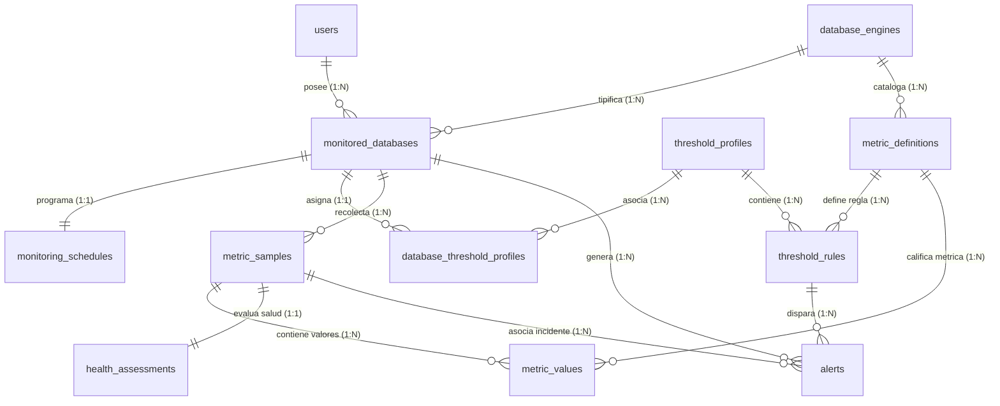

# DB Health Monitor (v1.0)
### Plataforma de Observabilidad Proactiva y Diagnóstico de Salud para Bases de Datos NoSQL y en Memoria

[](#pipeline-de-cicd-y-automatización)
[](#módulos-del-sistema)
[-336791?style=for-the-badge&logo=postgresql&logoColor=white)](#modelo-de-datos-relacional-en-3fn)
[](#arquitectura-de-software)
[](#arquitectura-de-software)
[](#despliegue-reproducible)

---

## 🏛️ Información Institucional y Equipo de Proyecto

* **Institución:** Universidad Privada de Tacna (UPT)
* **Facultad:** Facultad de Ingeniería (FAING)
* **Escuela:** Escuela Profesional de Ingeniería de Sistemas (EPIS)
* **Asignatura:** SI-783 Base de Datos II (2026-II)
* **Equipo de Desarrollo:** **Grupo 3**
* **Repositorio Oficial:** [`UPT-FAING-EPIS/si783-2026-ii-si783-2026-ii-proyecto-group-3`](https://github.com/UPT-FAING-EPIS/si783-2026-ii-si783-2026-ii-proyecto-group-3)
* **Despliegue en Producción (Demo):** [frontend-production-07c5.up.railway.app](https://frontend-production-07c5.up.railway.app)
* **Portal de Documentación Técnica:** [GitHub Pages Documentation](https://upt-faing-epis.github.io/si783-2026-ii-si783-2026-ii-proyecto-group-3/)

---

## 💡 ¿Qué es DB Health Monitor?

**DB Health Monitor** es una plataforma centralizada y multiusuario de observabilidad para **MongoDB** y **Redis**. Permite a DBAs, ingenieros DevOps y líderes técnicos supervisar la salud integral de sus bases de datos en tiempo real mediante un enfoque no invasivo:

1. **Arquitectura 100% Agentless (Sin Agentes):** No requiere instalar software residente en los servidores clientes. Extrae telemetría mediante conexiones remotas estándar y comandos nativos ligeros de solo lectura (`serverStatus`, `INFO`).
2. **Score de Salud Determinista (0 a 100):** Consolida 47 métricas técnicas en un indicador de salud comprensible en 3 segundos (`Saludable: 80-100`, `Advertencia: 50-79`, `Crítico: 0-49`), con explicaciones legibles de causas de penalización.
3. **Alertamiento Proactivo vía Telegram Bot:** Envía notificaciones instantáneas push a los dispositivos móviles de guardia ante caídas de conexión o violación de umbrales, con control inteligente de duplicados.
4. **Seguridad Zero-Trust:** Cifrado simétrico en reposo con **AES-128 Fernet** para cadenas de conexión, hasheo de contraseñas de usuarios con **Argon2id** y autenticación stateless con **JWT**.

---

## 🏗️ Arquitectura de Software

El sistema está estructurado como un **Monolito Modular** de alto rendimiento, aplicando los principios de la Arquitectura Hexagonal (Puertos y Adaptadores) y el Patrón Repositorio.

```mermaid
graph TD
    User["👤 Usuario / DBA"] -->|HTTPS / WSS| Nginx["🌐 Nginx Web Proxy (Puerto 8080)"]
    Nginx -->|Sirve SPA estática| ReactApp["⚛️ React 19 + TypeScript SPA"]
    Nginx -->|Redirige /api/v1| FastAPI["⚡ Backend API (FastAPI / Python 3.13)"]
    
    FastAPI -->|Autenticación & Consultas| PostgreSQL[("🐘 PostgreSQL 16 (Plataforma 3FN)")]
    
    subgraph "Worker de Monitoreo Autónomo"
        Worker["🔄 Background Worker (Python 3.13)"]
        Worker -->|Reserva concurrente: SKIP LOCKED| PostgreSQL
        Worker -->|Despacha alertas| TelegramBot["📱 Telegram Bot API (Push Notifications)"]
    end
    
    subgraph "Infraestructura Monitoreada (Agentless)"
        Worker -->|db.command('serverStatus')| MongoDB[("🍃 MongoDB Clúster / Instancia")]
        Worker -->|INFO / PING de solo lectura| Redis[("⚡ Redis Instancia / Caché")]
    end

    classDef primary fill:#0284c7,stroke:#0369a1,color:#fff;
    classDef secondary fill:#0f172a,stroke:#334155,color:#fff;
    classDef highlight fill:#059669,stroke:#047857,color:#fff;
    class ReactApp,FastAPI primary;
    class PostgreSQL,Worker secondary;
    class MongoDB,Redis,TelegramBot highlight;
```

---

## 🗄️ Modelo de Datos Relacional en 3FN

PostgreSQL 16 almacena la configuración de la plataforma, usuarios, catálogos, historial de métricas y alertas. Cumple estrictamente la **Tercera Forma Normal (3FN)**:



Para la especificación exhaustiva columna por columna, tipos de datos, restricciones e índices, consulte:  
📖 **[Diccionario de Datos Completo de PostgreSQL](docs/data-dictionary.md)**

---

## 📦 Módulos del Sistema y Entregables de la Rúbrica

| Módulo / Directorio | Descripción y Propósito | Estado / Rúbrica |
| :--- | :--- | :---: |
| [`backend/`](backend/) | API REST en FastAPI, worker de fondo y modelos de dominio. | ✅ Verificado (55+ tests) |
| [`frontend/`](frontend/) | Interfaz gráfica SPA en React 19, TypeScript, Vitest y gráficos SVG. | ✅ Verificado |
| [`terraform/`](terraform/) | Infraestructura como Código (IaC) en AWS y [Estimación de Costos](terraform/COSTOS_ESTIMACION.md). | ✅ Aprovisionable |
| [`liquibase/`](liquibase/) | Control de versiones de la BD con changelogs XML y [Reporte Técnico](liquibase/report/REPORTE_MIGRACIONES_LIQUIBASE.md). | ✅ Versionado |
| [`backups/`](backups/) | Scripts automatizados de backup (`pg_dump`), verificación SHA-256 y [Plan DRP](backups/report/REPORTE_BACKUPS_Y_RECUPERACION.md). | ✅ Probado (<5s RTO) |
| [`.github/workflows/`](.github/workflows/) | Pipelines de CI (pruebas/linters), CD de Release y despliegue a GitHub Pages. | ✅ Automatizado |
| [`docs/`](docs/) | Documentación técnica, modelo de datos, catálogo y auditorías para GitHub Pages. | ✅ Publicable |

---

## 🚀 Despliegue Rápido y Ejecución

### 1. Despliegue Local con Docker Compose (Recomendado)
Requiere tener instalados Docker y Docker Compose:

```powershell
# 1. Generar variables de entorno seguras
.\deploy\generate-env.ps1

# 2. Levantar toda la plataforma en contenedores aislados
docker compose --env-file .env.deploy up --build -d

# 3. Comprobar estado de los servicios
docker compose --env-file .env.deploy ps
```
La aplicación queda disponible inmediatamente en: **`http://localhost:8080`**

Para detener los contenedores conservando los datos de PostgreSQL:
```powershell
docker compose --env-file .env.deploy down
```

---

### 2. Infraestructura en la Nube con Terraform (AWS)
```bash
cd terraform
cp terraform.tfvars.example terraform.tfvars
terraform init
terraform plan
terraform apply
```
*(Al finalizar, Terraform devuelve la URL e IP pública de la instancia aprovisionada).*

---

### 3. Migraciones de Base de Datos con Liquibase
Ejecución sin necesidad de instalar Java (utilizando el contenedor oficial de Liquibase):
```powershell
# Aplicar todos los changesets pendientes:
.\liquibase\run-liquibase.ps1 -Action update

# Ver historial de cambios aplicados:
.\liquibase\run-liquibase.ps1 -Action history
```

---

### 4. Respaldo y Restauración de Base de Datos (Backups & DRP)
```powershell
# Generar un respaldo inmediato con rotación automática de 7 días:
.\backups\scripts\backup.ps1

# Restaurar con validación criptográfica previa SHA-256:
.\backups\scripts\restore.ps1
```

---

## 🧪 Pruebas Automatizadas y Calidad de Código

El proyecto cuenta con suites de pruebas unitarias, de integración y extremo a extremo:

* **Pruebas de Backend (Pytest):**
  ```powershell
  cd backend
  pytest -m "not real_services" -v
  ```
* **Linter de Backend (Ruff):**
  ```powershell
  cd backend
  ruff check .
  ```
* **Pruebas y Linter de Frontend (Vitest + ESLint):**
  ```powershell
  cd frontend
  npm run lint
  npm run test
  npm run build
  ```
* **Pruebas E2E Aisladas (Navegador real con Docker):**
  ```powershell
  .\deploy\run-e2e.ps1
  ```

---

## 📄 Informes y Documentos Oficiales del Proyecto

En la raíz del repositorio se encuentran los informes formales de ingeniería de software en formatos `.docx` y `.pdf`:

* 📑 **FD01:** Informe de Factibilidad y Viabilidad del Proyecto.
* 📑 **FD02:** Documento de Visión y Alcance.
* 📑 **FD03:** Especificación de Requerimientos de Software (SRS).
* 📑 **FD04:** Informe de Arquitectura de Software (SAD).
* 📑 **FD05:** Informe Final del Proyecto.
* 📑 **FD06:** Propuesta de Proyecto.
* 🎤 **[GUIA_EXPOSICION_PROYECTO.txt](GUIA_EXPOSICION_PROYECTO.txt):** Guion de exposición de 7 minutos, pitch de alto impacto y respuestas a las 6 preguntas más difíciles del jurado.
