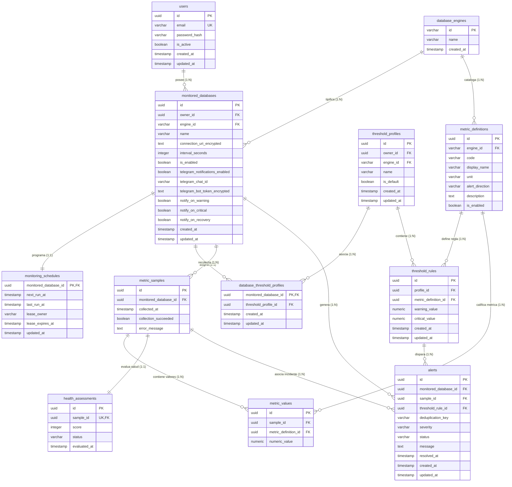

# Diccionario de Datos — Base de Datos Relacional PostgreSQL
## DB Health Monitor (v1.0)
**Institución:** Universidad Privada de Tacna (UPT) — Facultad de Ingeniería (EPIS)  
**Curso:** SI-783 Base de Datos II  
**Grupo:** Grupo 3  
**Motor de Persistencia:** PostgreSQL 16 (Normalizado en Tercera Forma Normal - 3FN)  
**Esquema:** `public`  

---

## 1. Diagrama Entidad-Relación (DER)

---

## 2. Detalle Estructural por Tabla

### Tabla 1: `users`
Almacena los usuarios administradores de la plataforma con autenticación segura y contraseñas hasheadas.

| Columna | Tipo de Dato | Nulo | Por Defecto | Llave | Descripción |
| :--- | :--- | :---: | :---: | :---: | :--- |
| `id` | `UUID` | NO | — | **PK** | Identificador único del usuario (UUID v4). |
| `email` | `VARCHAR(255)` | NO | — | **UK** | Correo electrónico de inicio de sesión (único). |
| `password_hash` | `VARCHAR(255)` | NO | — | — | Contraseña protegida mediante algoritmo **Argon2id**. |
| `is_active` | `BOOLEAN` | NO | `TRUE` | — | Estado operativo de la cuenta de usuario. |
| `created_at` | `TIMESTAMPTZ` | NO | `NOW()` | — | Fecha y hora de registro en UTC. |
| `updated_at` | `TIMESTAMPTZ` | NO | `NOW()` | — | Fecha y hora de la última modificación. |

* **Restricciones:** `uq_users_email` (UNIQUE).

---

### Tabla 2: `database_engines`
Catálogo maestro de motores de bases de datos NoSQL y en memoria soportados.

| Columna | Tipo de Dato | Nulo | Por Defecto | Llave | Descripción |
| :--- | :--- | :---: | :---: | :---: | :--- |
| `id` | `VARCHAR(40)` | NO | — | **PK** | Identificador del motor (`mongodb`, `redis`). |
| `name` | `VARCHAR(100)` | NO | — | — | Nombre legible comercial del motor. |
| `created_at` | `TIMESTAMPTZ` | NO | `NOW()` | — | Fecha de registro del motor en el catálogo. |

---

### Tabla 3: `monitored_databases`
Instancias de bases de datos registradas por cada usuario para su monitoreo continuo.

| Columna | Tipo de Dato | Nulo | Por Defecto | Llave | Descripción |
| :--- | :--- | :---: | :---: | :---: | :--- |
| `id` | `UUID` | NO | — | **PK** | Identificador único de la base de datos monitoreada. |
| `owner_id` | `UUID` | NO | — | **FK** | Referencia a `users(id)` (Aislamiento de propiedad). |
| `engine_id` | `VARCHAR(40)` | NO | — | **FK** | Referencia a `database_engines(id)`. |
| `name` | `VARCHAR(120)` | NO | — | — | Nombre asignado por el usuario a la instancia. |
| `connection_uri_encrypted` | `TEXT` | NO | — | — | Cadena de conexión cifrada simétricamente con **AES-128 Fernet**. |
| `interval_seconds` | `INTEGER` | NO | `30` | — | Frecuencia de recolección en segundos (10 a 86400s). |
| `is_enabled` | `BOOLEAN` | NO | `TRUE` | — | Bandera para pausar o activar el monitoreo del worker. |
| `telegram_notifications_enabled` | `BOOLEAN` | NO | `FALSE` | — | Habilita el despacho de alertas a Telegram. |
| `telegram_chat_id` | `VARCHAR(100)` | SÍ | `NULL` | — | Identificador de chat o canal de Telegram receptor. |
| `telegram_bot_token_encrypted` | `TEXT` | SÍ | `NULL` | — | Token personalizado del bot cifrado en reposo. |
| `notify_on_warning` | `BOOLEAN` | NO | `FALSE` | — | Si despacha mensajes ante eventos de Advertencia. |
| `notify_on_critical` | `BOOLEAN` | NO | `TRUE` | — | Si despacha mensajes ante eventos Críticos. |
| `notify_on_recovery` | `BOOLEAN` | NO | `TRUE` | — | Si despacha mensaje cuando la instancia se recupera. |
| `created_at` | `TIMESTAMPTZ` | NO | `NOW()` | — | Fecha de registro. |
| `updated_at` | `TIMESTAMPTZ` | NO | `NOW()` | — | Fecha de actualización de configuración. |

* **Restricciones:** `uq_monitored_database_owner_engine_name` (UNIQUE compuesto `owner_id, engine_id, name`).
* **Índices:** `ix_monitored_databases_owner_id`.

---

### Tabla 4: `monitoring_schedules`
Planificador concurrente para la reserva atómica de recolecciones de los workers de fondo.

| Columna | Tipo de Dato | Nulo | Por Defecto | Llave | Descripción |
| :--- | :--- | :---: | :---: | :---: | :--- |
| `monitored_database_id` | `UUID` | NO | — | **PK, FK** | Referencia 1:1 a `monitored_databases(id)`. |
| `next_run_at` | `TIMESTAMPTZ` | NO | `NOW()` | — | Marca de tiempo del próximo ciclo de recolección. |
| `last_run_at` | `TIMESTAMPTZ` | SÍ | `NULL` | — | Marca de tiempo del último ciclo exitoso. |
| `lease_owner` | `VARCHAR(100)` | SÍ | `NULL` | — | Identificador del worker que adquirió el bloqueo. |
| `lease_expires_at` | `TIMESTAMPTZ` | SÍ | `NULL` | — | Tiempo límite del arrendamiento temporal. |
| `updated_at` | `TIMESTAMPTZ` | NO | `NOW()` | — | Última actualización del planificador. |

* **Índices:** `ix_schedules_next_run_lease` (`next_run_at, lease_expires_at`). Permite reservas rápidas mediante `SELECT ... FOR UPDATE SKIP LOCKED`.

---

### Tabla 5: `metric_definitions`
Catálogo unificado de las 47 métricas técnicas extraídas de MongoDB y Redis.

| Columna | Tipo de Dato | Nulo | Por Defecto | Llave | Descripción |
| :--- | :--- | :---: | :---: | :---: | :--- |
| `id` | `UUID` | NO | — | **PK** | Identificador de la definición de métrica. |
| `engine_id` | `VARCHAR(40)` | NO | — | **FK** | Referencia a `database_engines(id)`. |
| `code` | `VARCHAR(80)` | NO | — | — | Código normalizado (`memory_usage_percent`, etc.). |
| `display_name` | `VARCHAR(120)` | NO | — | — | Nombre legible para la interfaz gráfica. |
| `unit` | `VARCHAR(40)` | NO | — | — | Unidad de medida (`percent`, `bytes`, `clients`). |
| `alert_direction` | `VARCHAR(20)` | NO | — | — | Dirección de riesgo (`above` si sube, `below` si baja). |
| `description` | `TEXT` | NO | — | — | Explicación técnica de la métrica y su impacto. |
| `is_enabled` | `BOOLEAN` | NO | `TRUE` | — | Habilitación en la recolección. |

* **Restricciones:** `uq_metric_definitions_engine_code` (UNIQUE `engine_id, code`).

---

### Tabla 6: `threshold_profiles`
Perfiles reutilizables de umbrales que definen las políticas de advertencia y estado crítico.

| Columna | Tipo de Dato | Nulo | Por Defecto | Llave | Descripción |
| :--- | :--- | :---: | :---: | :---: | :--- |
| `id` | `UUID` | NO | — | **PK** | Identificador del perfil de umbrales. |
| `owner_id` | `UUID` | NO | — | **FK** | Referencia a `users(id)`. |
| `engine_id` | `VARCHAR(40)` | NO | — | **FK** | Referencia a `database_engines(id)`. |
| `name` | `VARCHAR(100)` | NO | — | — | Nombre del perfil (ej: "Predeterminado"). |
| `is_default` | `BOOLEAN` | NO | `FALSE` | — | Indica si es el perfil asignado automáticamente al crear BD. |
| `created_at` | `TIMESTAMPTZ` | NO | `NOW()` | — | Fecha de creación. |
| `updated_at` | `TIMESTAMPTZ` | NO | `NOW()` | — | Fecha de última edición. |

---

### Tabla 7: `threshold_rules`
Reglas específicas asignadas a cada métrica dentro de un perfil de umbrales.

| Columna | Tipo de Dato | Nulo | Por Defecto | Llave | Descripción |
| :--- | :--- | :---: | :---: | :---: | :--- |
| `id` | `UUID` | NO | — | **PK** | Identificador de la regla de umbral. |
| `profile_id` | `UUID` | NO | — | **FK** | Referencia a `threshold_profiles(id)`. |
| `metric_definition_id` | `UUID` | NO | — | **FK** | Referencia a `metric_definitions(id)`. |
| `warning_value` | `NUMERIC(18,6)` | NO | — | — | Valor numérico que dispara estado Advertencia (*Warning*). |
| `critical_value` | `NUMERIC(18,6)` | NO | — | — | Valor numérico que dispara estado Crítico (*Critical*). |
| `created_at` | `TIMESTAMPTZ` | NO | `NOW()` | — | Fecha de creación. |
| `updated_at` | `TIMESTAMPTZ` | NO | `NOW()` | — | Fecha de actualización. |

* **Restricciones:** `uq_threshold_rule_profile_metric` (UNIQUE `profile_id, metric_definition_id`).

---

### Tabla 8: `database_threshold_profiles`
Asociación entre cada base de datos monitoreada y su perfil de umbrales activo.

| Columna | Tipo de Dato | Nulo | Por Defecto | Llave | Descripción |
| :--- | :--- | :---: | :---: | :---: | :--- |
| `monitored_database_id` | `UUID` | NO | — | **PK, FK** | Referencia a `monitored_databases(id)`. |
| `threshold_profile_id` | `UUID` | NO | — | **FK** | Referencia a `threshold_profiles(id)`. |
| `created_at` | `TIMESTAMPTZ` | NO | `NOW()` | — | Fecha de asignación. |
| `updated_at` | `TIMESTAMPTZ` | NO | `NOW()` | — | Fecha de actualización. |

---

### Tabla 9: `metric_samples`
Registros históricos inmutables de cada ciclo de recolección de telemetría.

| Columna | Tipo de Dato | Nulo | Por Defecto | Llave | Descripción |
| :--- | :--- | :---: | :---: | :---: | :--- |
| `id` | `UUID` | NO | — | **PK** | Identificador único de la muestra. |
| `monitored_database_id` | `UUID` | NO | — | **FK** | Referencia a `monitored_databases(id)`. |
| `collected_at` | `TIMESTAMPTZ` | NO | — | — | Timestamp exacto en UTC del ciclo de recolección. |
| `collection_succeeded` | `BOOLEAN` | NO | — | — | `TRUE` si la conexión y lectura fueron exitosas. |
| `error_message` | `TEXT` | SÍ | `NULL` | — | Descripción del fallo si la conexión se interrumpió. |

* **Índices:** `ix_metric_samples_database_collected` (`monitored_database_id, collected_at`).

---

### Tabla 10: `metric_values`
Almacenamiento atómico de cada valor numérico individual capturado en una muestra.

| Columna | Tipo de Dato | Nulo | Por Defecto | Llave | Descripción |
| :--- | :--- | :---: | :---: | :---: | :--- |
| `id` | `UUID` | NO | — | **PK** | Identificador del registro atómico. |
| `sample_id` | `UUID` | NO | — | **FK** | Referencia a `metric_samples(id)`. |
| `metric_definition_id` | `UUID` | NO | — | **FK** | Referencia a `metric_definitions(id)`. |
| `numeric_value` | `NUMERIC(20,6)` | NO | — | — | Valor cuantitativo recolectado en ese ciclo. |

* **Restricciones:** `uq_metric_value_sample_definition` (UNIQUE `sample_id, metric_definition_id`).

---

### Tabla 11: `health_assessments`
Evaluación consolidada del Health Score (0 a 100) derivada de cada muestra de métricas.

| Columna | Tipo de Dato | Nulo | Por Defecto | Llave | Descripción |
| :--- | :--- | :---: | :---: | :---: | :--- |
| `id` | `UUID` | NO | — | **PK** | Identificador de la evaluación. |
| `sample_id` | `UUID` | NO | — | **UK, FK** | Referencia 1:1 a `metric_samples(id)`. |
| `score` | `INTEGER` | NO | — | — | Puntaje consolidado entre 0 y 100 puntos. |
| `status` | `VARCHAR(20)` | NO | — | — | Estado operativo (`healthy`, `warning`, `critical`). |
| `evaluated_at` | `TIMESTAMPTZ` | NO | — | — | Timestamp en que se calculó la salud. |

* **Check Constraints:**  
  * `ck_health_assessment_score_range`: `score >= 0 AND score <= 100`  
  * `ck_health_assessment_status`: `status IN ('healthy', 'warning', 'critical', 'unknown')`

---

### Tabla 12: `alerts`
Ciclo de vida de incidentes y alarmas generadas ante degradación de salud o violaciones de umbral.

| Columna | Tipo de Dato | Nulo | Por Defecto | Llave | Descripción |
| :--- | :--- | :---: | :---: | :---: | :--- |
| `id` | `UUID` | NO | — | **PK** | Identificador único de la alerta. |
| `monitored_database_id` | `UUID` | NO | — | **FK** | Referencia a `monitored_databases(id)`. |
| `sample_id` | `UUID` | SÍ | `NULL` | **FK** | Referencia a la muestra que originó el incidente. |
| `threshold_rule_id` | `UUID` | SÍ | `NULL` | **FK** | Regla que fue sobrepasada (si aplica). |
| `deduplication_key` | `VARCHAR(120)` | NO | — | — | Clave única de condición para evitar alertas repetidas en bucle. |
| `severity` | `VARCHAR(20)` | NO | — | — | Nivel de gravedad (`warning`, `critical`). |
| `status` | `VARCHAR(20)` | NO | `'open'` | — | Ciclo de vida (`open`, `acknowledged`, `resolved`). |
| `message` | `TEXT` | NO | — | — | Explicación legible del incidente. |
| `resolved_at` | `TIMESTAMPTZ` | SÍ | `NULL` | — | Fecha y hora en que la condición volvió a la normalidad. |
| `created_at` | `TIMESTAMPTZ` | NO | `NOW()` | — | Fecha de apertura de la alerta. |
| `updated_at` | `TIMESTAMPTZ` | NO | `NOW()` | — | Última actualización de estado. |

* **Check Constraints:**  
  * `ck_alert_severity`: `severity IN ('warning', 'critical')`  
  * `ck_alert_status`: `status IN ('open', 'acknowledged', 'resolved')`  
* **Índices y Clave de Deduplicación:**  
  * `uq_alerts_database_dedup_active`: Índice único parcial en `(monitored_database_id, deduplication_key)` para alertas en estado `('open', 'acknowledged')`. Impide generar spam de alertas mientras el incidente siga abierto.
  * `ix_alerts_database_status`: Búsqueda indexada por base de datos y estado.
